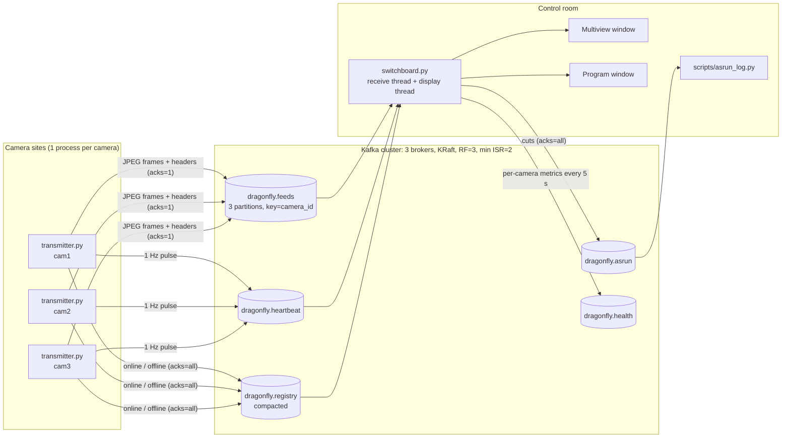

# Dragonfly: Distributed Live-Stream Ingestion Mesh

**Course:** CSCE A690 Distributed Computing, Assignment 1
**Framework:** Apache Kafka (KRaft mode), Python 3.11+ (`confluent-kafka`, OpenCV, NumPy)

Dragonfly takes in live video from many cameras through a replicated Kafka
cluster and delivers it to a **switchboard**: a production-control-room
application with a **multiview** (every camera at once) and a **program output**
(the camera on air). The operator cuts between cameras with the number keys, and
every cut is written to a durable **as-run log**.

Cameras are simulated by playing video files in real time, one process per
camera. The software does not know they are files: each transmitter is an
independent process that could run on a different machine. That is exactly how
the cloud deployment runs it, over the internet.

---

## Contents

1. [The problem](#1-the-problem)
2. [Architecture](#2-architecture)
3. [Design decisions and trade-offs](#3-design-decisions-and-trade-offs)
4. [Distributed-systems principles](#4-distributed-systems-principles)
5. [Prerequisites](#5-prerequisites)
6. [Local quickstart](#6-local-quickstart)
7. [Cloud deployment](#7-cloud-deployment)
8. [Demo script](#8-demo-script-with-failure-drills)
9. [Known limitations](#9-known-limitations)
10. [Reference](#10-reference-configuration-layout-tests)
11. [AI disclosure and attestation](#11-ai-disclosure-and-attestation)

---

## 1. The problem

A live production, such as a sports venue, a concert or a news studio, has many
cameras that all need to reach one control room, live, at once. The obvious
design is a single ingest server that every camera streams to. It fails in two
ways.

**It does not scale.** One 4K frame encoded as JPEG is about 1.2–2.5 MB
(measured on this project's 4K test clip at quality 80–90). At 30 fps that is
**about 290–600 Mbit/s per camera**. Ten such cameras need 3–6 Gbit/s of
sustained ingest, more than a typical server's network card, disk or CPU can
absorb. All of it lands on one machine.

**It is a single point of failure.** If that server crashes, is rebooted for an
update, or loses its network link, **every** camera goes dark at the same time,
in the middle of a live broadcast.

**Dragonfly's answer** is to place a distributed log between the cameras and the
control room:

* **Load is spread** across brokers by partitioning. Each camera's stream lives
  in one partition, and partitions are distributed over the brokers, so adding
  brokers adds capacity.
* **Data is replicated** to three brokers. One broker can die and video keeps
  flowing. This is demonstrated live in the demo.
* **Producers and consumers are decoupled.** Cameras do not know or care who is
  watching. The switchboard can restart, and other consumers (a recorder, a
  second operator) could read the same streams independently.
* **Failures are visible, not silent.** Heartbeats and a registry let the
  switchboard tell "camera stopped", "camera crashed" and "network problem"
  apart.

## 2. Architecture



**Inside the switchboard** there are two threads that share state only
through a lock:

```
 Kafka ──► receive thread (common/feeds.py)                 main thread (switchboard.py)
           consume batch ─► validate headers                ┌──────────────────────────┐
                         ─► reassemble chunks               │ snapshot() under lock     │
                         ─► newest frame per camera only    │ render tiles (cached)     │
                         ─► decode at reduced size          │ imshow / waitKey (60 Hz)  │
                         ─► under lock: store if seq newer ─┤ keys 1–9 ─► as-run event  │
           heartbeats / registry ─► liveness                │ every 5 s ─► health      │
           metadata probe ─► connected / broker count       └──────────────────────────┘
```

### Topics

| Topic | Purpose | Key | Partitions | Config |
|---|---|---|---|---|
| `dragonfly.feeds` | JPEG video frames (value = raw JPEG bytes, metadata in headers) | `camera_id` | 3 | `retention.ms` = 5 min, `max.message.bytes` = 1 MiB |
| `dragonfly.registry` | Camera online/offline state (file, resolution, fps, host) | `camera_id` | 3 | `cleanup.policy=compact` |
| `dragonfly.heartbeat` | 1 Hz liveness pulse per camera | `camera_id` | 3 | `retention.ms` = 60 s |
| `dragonfly.asrun` | Every switchboard cut (`ts`, `from_cam`, `to_cam`) | none | 1 (one total order) | `retention.ms` = 7 days |
| `dragonfly.health` | Per-camera fps, latency, skipped/lost frames, every 5 s | `camera_id` | 3 | `retention.ms` = 1 day |

On the local cluster every topic has replication factor 3 and
`min.insync.replicas=2`.

**Frame headers:** `camera_id`, `seq`, `capture_ts_ns`, `media_pos_ms`,
`chunk_idx`, `chunk_total`, `source_name`.

## 3. Design decisions and trade-offs

| Decision | Why | Trade-off accepted |
|---|---|---|
| **Kafka as the only framework**: no database, no Redis | Kafka already provides a durable, replicated, partitioned log. The registry (compacted topic), as-run log (retained topic) and health (time-limited topic) are all just topics, so one system holds all the state and there is one thing to operate. | Queries like "all cuts by camera" mean replaying a topic rather than running SQL. That's fine at this scale. |
| **Raw JPEG bytes as the message value, metadata in Kafka headers** (not JSON with base64) | Base64 inflates binary data by **~33 %** (3 bytes become 4 characters) and costs CPU to encode and decode on every frame, at both ends. Headers let the switchboard validate and route a frame without touching the image bytes. | Messages are not self-describing JSON. You need the header list (above) to read them. |
| **Producer compression off for frames** | JPEG is already compressed. gzip/lz4/zstd would burn CPU and add latency for roughly 0 % gain. The topic uses `compression.type=producer` so the broker never recompresses. | None in practice. |
| **Partition key = `camera_id`** | Kafka guarantees order **within a partition**. Keying by camera puts every frame of one camera on one partition, in order, so there is no cross-machine coordination and no locks between transmitters. Different cameras spread across partitions and brokers. | One camera's throughput is limited to one partition (one leader broker). At 4K that is still only about 75 MB/s, well within a broker's capacity. |
| **Keep only the latest frame per camera** (overwrite, never queue) | A queue between the network and the display lets latency **compound**: if the display is 1 ms slower per frame than the camera, delay grows without bound. Overwriting bounds the delay to one frame. The receive thread goes further: in each batch it decodes only the **newest complete frame per camera** and skips older ones, so a backlog (after an outage, or on a slow machine) is dropped, not replayed. | Under CPU pressure the display shows fewer distinct frames per second; it never shows *older* ones. |
| **At-most-once delivery for frames** (`acks=1`, 5 s delivery timeout) | A lost frame is replaced by the next one 33 ms later. Waiting for every replica or retrying for a long time only adds latency to data that is already stale. | A broker crash can lose the frames it had not yet replicated. Health records count these as `gaps`. |
| **Durable delivery for control data** (`acks=all`, idempotent producer) | Registry records and as-run cuts are facts that must not be lost. With `min.insync.replicas=2` a record counts as written only once it is on two brokers. | Slightly higher latency for these rare messages. Irrelevant. |
| **Switchboard never commits offsets**; `auto.offset.reset=latest` | A restarted switchboard starts at the **live edge** instead of replaying minutes of stale video. Measured: first live frame **0.2–0.4 s** after restart. | A switchboard does not see video sent while it was down, which is correct for live TV. |
| **Registry read from the beginning** (compacted topic) | A compacted topic keeps the last record per key forever. On start the switchboard learns which cameras are online or offline without anyone resending. | Must override the offset for that one topic (done in `on_assign`). |
| **Frames over ~900 KB are split into chunks** | Kafka's default message limit is about 1 MB. Chunks share `(camera_id, seq)`, arrive in order on one partition, and are reassembled. Incomplete frames are evicted after 1 s and the number of open assemblies is capped (bounded memory). | A lost chunk loses the whole frame (consistent with at-most-once). |
| **All OpenCV window calls on the main thread; Kafka on a background thread; shared state under a lock** | OpenCV's GUI (HighGUI) is not thread-safe and on some platforms must run on the main thread. Kafka polling must never freeze the UI, and the UI must never stall consumption. | Two threads to reason about, with exactly one shared structure (see §4). |
| **Decode JPEG at reduced size** (1/2, 1/4, 1/8) | A 4K frame shown in a 1280-px window needs only 1920×1080 of detail. libjpeg can skip the rest *during* decoding, several times faster than decoding everything and shrinking it. | None visible. The size is chosen per camera so the program window is always filled at full sharpness. |
| **Deadline-based pacing** (not `sleep(1/fps)`) | `sleep(1/fps)` drifts because encode and send time add to every frame. The pacer keeps an absolute schedule. When it falls behind it drops at most one frame per loop and then resyncs, because skipping costs a video decode and unbounded catch-up made an overloaded 4K sender spiral down to 0.4 fps. | When overloaded, the sender settles at the rate the machine can sustain (shown in its stats line). |
| **1 ms timer resolution on Windows** | librdkafka's network threads wait on the OS timer, which ticks every 15.6 ms on Windows. Two ticks (31.2 ms) beat against the 33.3 ms frame interval, and **49 %** of frames arrived in pairs, so the screen showed about 18 fps from a 30 fps camera. With `timeBeginPeriod(1)` that fell to **0 %**. | Slightly higher power use on Windows laptops while Dragonfly runs. |
| **Configuration through CLI flags with `DRAGONFLY_*` environment-variable fallbacks** | The same code runs locally and in the cloud. Only `--brokers` / `DRAGONFLY_BROKERS` changes. Nothing secret is in the repo (`.env` is gitignored). | None. |

## 4. Distributed-systems principles

### Where race conditions could occur, and how each is prevented

| Possible race | Prevention | Where |
|---|---|---|
| Frames of one camera arrive out of order (different network paths, retries, brokers) | Keyed by `camera_id`, so a single partition gives a total order per camera | `transmitter.py` (`key=camera_id`) |
| A duplicate or late frame overwrites a newer one | Per-camera sequence check: a frame is stored only if `seq` is higher | `accept_seq()` in `common/feeds.py` |
| A transmitter restarts and its `seq` begins again at 0 | A lower `seq` is accepted only after at least 1 s of silence. A real restart always has that gap. | `accept_seq()` |
| **Two transmitters with the same camera id** (misconfiguration) | The live one wins. The other never goes silent, so its frames are rejected with a rate-limited warning instead of flickering. This happened during development and is now covered by a unit test. | `accept_seq()`, `tests/test_feeds.py` |
| Receive thread writes a frame while the display reads it | One lock guards the camera dictionary. Frames are **replaced, never modified in place**, so the display can render them outside the lock. | `FeedReceiver._lock`, `snapshot()` |
| Display thread blocks on Kafka, or Kafka stalls on rendering | Only the receive thread touches the consumer. The display only reads snapshots, and `producer.poll(0)` never blocks. | `common/feeds.py`, `Switchboard.run()` |
| OpenCV called from two threads | Every `imshow` / `waitKey` / `destroyAllWindows` is on the main thread | `switchboard.py` |
| Chunks of different frames interleave | Assembly is keyed by `(camera_id, seq)`, and inconsistent `chunk_total` is rejected | `Reassembler` in `common/frames.py` |
| Concurrent cuts from two switchboards | `dragonfly.asrun` has **one partition**, so all cuts share one total order | `common/config.py` |
| Memory grows without bound | The latest frame per camera only, evicted cameras are deleted, the chunk buffer is time- and count-bounded, the tile cache is pruned, and the producer queue is capped (64 MB, then frames are dropped, not queued) | throughout |

### Failure modes: observed behaviour

These rows were measured with scripted drills on the 3-broker local cluster
(Windows 11 laptop, Docker Desktop). The last row is designed behaviour,
supported by related measurements.

| Failure | What happens | Observed |
|---|---|---|
| **Transmitter crashes** (process killed or window closed) | Its tile shows **NO SIGNAL, "lost N s ago"** once frames stop for `--stale-ms`. After `--evict-s` with no frames or heartbeats, the camera is removed. When restarted it reappears automatically. Other cameras are unaffected. | NO SIGNAL after about 2 s, evicted after 15 s, a restarted camera returns at once |
| **Transmitter stops cleanly** (Ctrl+C) | It publishes an `offline` record, so the tile shows **"stopped (offline)"** immediately with no timeout | Immediately |
| **Transmitter alive but sending no video** | Heartbeats still arrive, so the tile shows **"transmitter alive, no video"** (a different diagnosis from a crash) | Unit-tested |
| **One broker dies** (`docker stop kafka2`) | Partitions it led elect a new leader from the in-sync replicas. Producers and the consumer follow automatically. The footer shows `Kafka: 2 broker(s)`. | Streams on affected partitions paused **about 2–4 s**, then resumed. The switchboard never stopped. Broker count 3 → 2 → 3 on restart. |
| **All brokers down** | A red **BROKER DISCONNECTED** footer and program banner appear. Tiles keep the last picture. Camera timers are frozen, so nothing is marked NO SIGNAL or evicted because of the outage. Transmitters keep running and count failed frames. Everything reconnects automatically. | Detected within about 2 s. After the cluster returned, latency was back to **about 50 ms within 1 s** (the backlog was skipped, not replayed). |
| **Switchboard restarts** | It rejoins at the live edge and relearns cameras from the registry and the frames | First frame **0.2–0.4 s** after start, about 11 ms latency, no replay |
| **Slow network / overloaded machine** | The transmitter's bounded send queue drops frames instead of blocking. The switchboard skips superseded frames instead of queueing. **Frame rate degrades; latency does not compound.** | Same mechanism observed under CPU overload: a 4K sender held about 11 fps instead of collapsing, and six simultaneous cameras dropped to about 21 fps shown at 20–60 ms latency |

## 5. Prerequisites

| Software | Version | Install (Windows) | Install (macOS / Linux) |
|---|---|---|---|
| Python | 3.11 or newer | `winget install -e --id Python.Python.3.12` | `brew install python@3.12` / `sudo apt install python3 python3-venv` |
| Docker | Desktop 4.x or Engine 24+ | `winget install -e --id Docker.DockerDesktop` | `brew install --cask docker` / see [docs.docker.com/engine/install](https://docs.docker.com/engine/install/) |
| Git | any | `winget install -e --id Git.Git` | `brew install git` / `sudo apt install git` |
| ffmpeg (only to convert your own clips) | 6+ with libx264 | `winget install -e --id Gyan.FFmpeg` | `brew install ffmpeg` / `sudo apt install ffmpeg` |

Python packages (in a virtual environment):

```powershell
python -m venv .venv
.venv\Scripts\Activate.ps1              # cmd: .venv\Scripts\activate.bat   bash: source .venv/bin/activate
pip install -r requirements.txt         # confluent-kafka, opencv-python, numpy, pytest, ruff
```

> **Anaconda users:** Anaconda's `ffmpeg` has no H.264 encoder, and it may come
> first on your PATH. Point the conversion script at the full build:
> `$env:DRAGONFLY_FFMPEG = (Resolve-Path "$env:LOCALAPPDATA\Microsoft\WinGet\Packages\Gyan.FFmpeg_*\ffmpeg-*-full_build\bin\ffmpeg.exe").Path`.
> Also make sure the prompt shows `(.venv)` before running anything, or you get
> Anaconda's Python without the packages (`ModuleNotFoundError: confluent_kafka`).

### Sample videos

Videos are not in the repository (they are large). Put 2–9 clips in
`sample_videos/` named `cam1.mp4`, `cam2.mp4`, … Phone footage (.MOV, variable
frame rate, rotated) should be converted first. The conversion fixes the frame
rate at 30 fps, applies rotation (portrait stays portrait) and removes audio:

```powershell
.\scripts\convert_video.ps1 sample_videos\IMG_1234.MOV sample_videos\cam1.mp4    # bash: scripts/convert_video.sh in out
```

Optional 4K test clip (about 1 GB, used to exercise chunking). It adds film
grain so the frames are as large as real 4K footage:

```powershell
ffmpeg -i sample_videos\cam1.mp4 -t 15 -an -vf "scale=3840:2160:flags=lanczos,noise=alls=10:allf=t,fps=30,format=yuv420p" -c:v libx264 -preset veryfast -crf 16 -g 30 sample_videos\uhd_4k.mp4
```

## 6. Local quickstart

*Simulating a multi-camera sports venue: three cameras, one control room, and
a three-broker cluster.* Run every command from the repo root with the venv
active.

```powershell
# 1. Start the 3-broker Kafka cluster (first run downloads the image)
docker compose up -d
docker compose ps                       # kafka1, kafka2, kafka3 all "Up"; wait ~15 s

# 2. Create the topics (safe to run again; existing topics are left alone)
python scripts/create_topics.py

# 3. Terminal A: the control room
python switchboard.py

# 4. Terminal B: one transmitter per sample_videos\cam*.mp4, each in its own window
.\scripts\run_demo_local.ps1            # cmd: scripts\run_demo_local.cmd   macOS/Linux: scripts/run_demo_local.sh
```

Or start any single camera by hand:

```powershell
python transmitter.py --camera-id cam1 --file sample_videos/cam1.mp4 --max-width 1280
```

**In the switchboard:** keys **1–9** cut to that tile, and **q** quits. Each
transmitter prints one stats line per second:

```
[cam1] fps  30.0 |   67.0 KB/frame | seq 916 | delivered 914 | failed 0 | skipped 0
```

**Inspect the system:**

```powershell
python scripts/asrun_log.py             # every cut, replayed from the topic (add --follow)
docker exec kafka1 /opt/kafka/bin/kafka-topics.sh --bootstrap-server kafka1:19092 --describe
docker exec kafka1 /opt/kafka/bin/kafka-console-consumer.sh --bootstrap-server kafka1:19092 --topic dragonfly.health --property print.key=true
docker exec kafka1 /opt/kafka/bin/kafka-console-consumer.sh --bootstrap-server kafka1:19092 --topic dragonfly.registry --from-beginning --property print.key=true
```

**Stop:** press Ctrl+C in each transmitter window and `q` in the switchboard,
then run `docker compose down`. Data persists on Docker volumes; add `-v` to
delete it.

## 7. Cloud deployment

[`cloud/azure_setup.md`](cloud/azure_setup.md) is a step-by-step guide to
running a **single Kafka broker on an Azure VM**, with your laptop's
transmitters and switchboard connecting over the internet. It covers:

* creating the VM and a network security group rule that opens port 9092
  **to your IP only**
* `advertised.listeners`, and why the broker must advertise its *public*
  address
* a JVM heap capped at 512 MB for a small VM ([`cloud/docker-compose.cloud.yml`](cloud/docker-compose.cloud.yml))
* creating topics with `--replication-factor 1 --min-isr 1`
* **controlling student-credit spend**: `az vm deallocate` whenever you are
  not using it (`az vm start` brings it back with the same IP), a **budget
  alert** in Cost Management, and deleting the resource group at the end

The only change from the local setup is `--brokers <vm-ip>:9092` (or
`DRAGONFLY_BROKERS`).

## 8. Demo script (with failure drills)

About 8 minutes, terminals only. **Rehearse it once beforehand.**

**Before class**

1. `docker compose up -d`, wait 20 s, then `python scripts/create_topics.py` (should say "exists").
2. Arrange the screen: **Multiview** window large, **Program** window beside
   it, and one terminal visible for commands.
3. For the cloud part: `az vm start ...`, update the NSG rule to the classroom
   IP ([azure_setup.md §3](cloud/azure_setup.md#3-open-ssh-and-kafka-to-your-ip-only)).

**Live**

| # | Do | Say / point out |
|---|---|---|
| 1 | `docker compose ps` | "Three Kafka brokers, each also a KRaft controller. Every topic is replicated three times." |
| 2 | `python switchboard.py` | Multiview shows NO CAMERAS. The footer reads `Kafka: 3 broker(s)`. |
| 3 | `.\scripts\run_demo_local.ps1` | Three independent processes. Tiles appear with latency (~20 ms) and fps. |
| 4 | Press **2**, **3**, **1** | The red border moves and the program window follows. Each cut goes to `dragonfly.asrun` with `acks=all`. |
| 5 | Ctrl+C in the cam2 window | **"stopped (offline)"** immediately: clean shutdown through the registry. |
| 6 | Close the cam3 window with **X** | A crash: no goodbye. After about 2 s, **NO SIGNAL, "lost N s ago"**, detected by silence and missing heartbeats. After 15 s the tile is removed. |
| 7 | Restart cam3: `python transmitter.py --camera-id cam3 --file sample_videos/cam3.mp4 --max-width 1280` | It comes back automatically. The new process starts at seq 0, and the switchboard accepts it after the silence. |
| 8 | `docker stop kafka2` | **Fault tolerance:** video keeps flowing. One stream may pause for 2–4 s while partition leadership moves. The footer drops to `2 broker(s)`. |
| 9 | `docker start kafka2` | It rejoins, and the footer returns to 3. |
| 10 | `docker compose stop` (all brokers) | **BROKER DISCONNECTED** (red). Pictures freeze on the last frame, and nothing is marked dead because of the outage. Transmitters keep running and count failures. |
| 11 | `docker compose start` | It reconnects by itself, and latency is back to normal within a second: the backlog is skipped, not replayed. |
| 12 | `python scripts/asrun_log.py` | The full cut history, read back from Kafka. |
| 13 | *(cloud)* `$env:DRAGONFLY_BROKERS="<vm-ip>:9092"`, then repeat steps 2–4 with `-MaxWidth 640` | The same code, over the internet. The footer shows 1 broker. |

**If something goes wrong:** `docker compose ps` (are the brokers up?), check
that the prompt shows `(.venv)`, and read the transmitter's stats line
(`failed` rising means it cannot reach Kafka).

## 9. Known limitations

* **Upload bandwidth is the ceiling.** Every frame crosses the network twice
  (camera to Kafka to switchboard). The sample clips at 1280 px are about
  70–115 KB/frame, or about 15–30 Mbit/s per camera at 30 fps. Home uploads
  need `--max-width 640`, `--fps 15` or `--jpeg-quality 70`. Motion-JPEG is
  simple and robust but far less efficient than H.264/H.265.
* **No audio.** Clips are converted video-only.
* **No frame-accurate sync between cameras.** Each transmitter plays its own
  file on its own clock. Cuts are instantaneous, but the clips do not show the
  same moment. Real productions synchronise cameras with genlock/PTP.
* **The single-broker cloud setup is not fault tolerant.** It shows network
  distribution only; fault tolerance is shown on the 3-broker local cluster.
* **No encryption or authentication.** Kafka runs PLAINTEXT. In the cloud,
  access is limited only by the firewall rule to one IP. Production would use
  TLS and SASL.
* **The latency figure assumes synchronised clocks.** It is
  `switchboard receive time − transmitter capture time`. That is exact when
  both run on one machine, but includes clock skew across machines.
* **One switchboard decodes every camera.** On the test laptop it showed 30 fps
  for three cameras. With six cameras plus six encoders on the same machine it
  dropped to about 21 fps (latency stayed low). A 4K transmitter is CPU-bound
  at about 11 fps on the same laptop.
* **Key numbers follow the sorted camera list.** When a camera is evicted, the
  tiles after it move up one key.

## 10. Reference: configuration, layout, tests

### Command-line options (each has an environment-variable fallback)

| Program | Option | Env var | Default |
|---|---|---|---|
| all | `--brokers` | `DRAGONFLY_BROKERS` | `localhost:9092,localhost:9094,localhost:9096` |
| all | `--verbose` | `DRAGONFLY_VERBOSE=1` | off |
| `transmitter.py` | `--camera-id` (required), `--file` (required) | | |
| | `--fps` | | the file's native rate |
| | `--max-width` | `DRAGONFLY_MAX_WIDTH` | no downscale |
| | `--jpeg-quality` | `DRAGONFLY_JPEG_QUALITY` | 80 |
| | `--loop` / `--no-loop`, `--start-sec` | | loop, 0 |
| `switchboard.py` | `--group` | `DRAGONFLY_GROUP` | `dragonfly-switchboard-<host>` |
| | `--stale-ms` | `DRAGONFLY_STALE_MS` | 2000 |
| | `--evict-s` | `DRAGONFLY_EVICT_S` | 15 |
| | `--max-width` | `DRAGONFLY_SWITCHBOARD_WIDTH` | 1280 |
| | `--grid` (`auto` or e.g. `3x2`) | `DRAGONFLY_GRID` | auto |
| `create_topics.py` | `--replication-factor`, `--min-isr` | `DRAGONFLY_REPLICATION_FACTOR`, `DRAGONFLY_MIN_ISR` | 3, 2 |

### Project layout

```
transmitter.py            camera process: file -> JPEG -> Kafka (pacing, heartbeat, registry)
switchboard.py            display thread: multiview, program, cuts, health publishing
common/
  config.py               topic names and configs, defaults, env-var helpers
  clients.py              Kafka producer/consumer factories (acks profiles, Windows timer fix)
  frames.py               JPEG encode/decode, chunking, reassembly, header build/parse
  feeds.py                switchboard receive thread: liveness, eviction, connection state
  pacing.py               deadline-based frame pacer
  render.py               drawing helpers (fit, grid, cards, banner)
  topics.py               idempotent topic creation
  log.py                  logging setup
scripts/
  create_topics.py        create all topics (local RF=3 or cloud RF=1)
  asrun_log.py            print the as-run log (replay from the beginning)
  run_demo_local.ps1/.cmd/.sh   start one transmitter per sample video
  convert_video.ps1/.sh   phone clip -> constant-fps, video-only H.264 MP4
docker-compose.yml        local 3-broker KRaft cluster
cloud/                    single-broker compose file + Azure guide
tests/                    pytest suite (frames, pacing, feeds, render)
```

### Tests and lint

```powershell
pytest -q        # 69 tests: chunk/header round-trips, corrupt input, pacing accuracy,
                 # NO SIGNAL / eviction / outage / backlog-skip behaviour, rendering
ruff check .     # lint (pycodestyle, pyflakes, isort, bugbear, pyupgrade, no blind except)
```

## 11. AI disclosure and attestation

> **To the student:** complete every `[placeholder]` honestly before
> submitting. Delete this note when done. Do not leave claims you cannot
> stand behind.

**Tools used.** Claude (Anthropic), through Claude Code, was used for
architecture brainstorming, design review, and code scaffolding. Claude also
ran tests and failure drills on my machine and proposed fixes for the problems
they revealed. [Add any other AI tools you used, or write "No other AI tools
were used."]

**What I specified.** [Describe in your own words what you decided yourself:
for example the problem choice, the framework choice, the technical decisions
listed in the project specification, and the milestone plan.]

**Files.** The table records who produced each file. "AI-generated" means Claude
wrote the initial version. Fill in the last column for every file you changed.

| File(s) | Initial version | Written or modified by me |
|---|---|---|
| `transmitter.py` | AI-generated (Claude) | [none / describe your changes] |
| `switchboard.py` | AI-generated (Claude) | [none / describe your changes] |
| `common/*.py` | AI-generated (Claude) | [none / describe your changes] |
| `scripts/*` | AI-generated (Claude) | [none / describe your changes] |
| `docker-compose.yml`, `cloud/*` | AI-generated (Claude) | [none / describe your changes] |
| `tests/*` | AI-generated (Claude) | [none / describe your changes] |
| `README.md` | AI-generated (Claude) | [none / describe your changes] |
| [any file you wrote yourself] | Written by me | |

**How I tested and verified the code.** [Describe what *you* ran and observed:
for example which demo steps and failure drills you performed yourself, on
what machine, and what you checked. Include the cloud run if you did it.]

**Understanding.** [State that you have read the code and can explain it,
including the threading model, the partitioning and race-condition
arguments, delivery guarantees and failure handling, or describe honestly
which parts you are still working to understand.]

**Attestation.** I confirm that this disclosure is accurate and complete.
— [Your name], [date]
